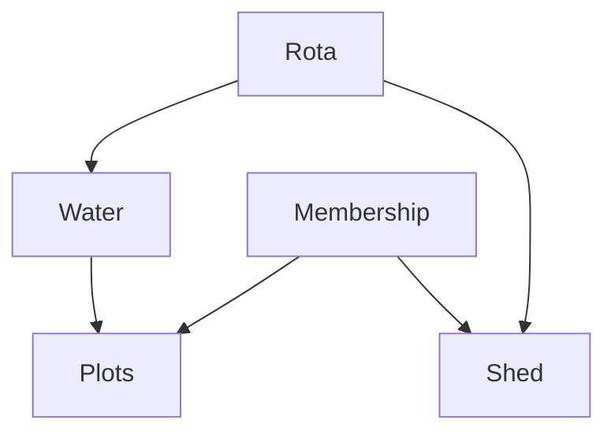

# Example: a community garden, still an idea (companion to the Strata Blueprints guide)

This companion fills the layers for a subject that is still an idea. A street of
households wants to grow food together, and nothing has been built or agreed yet.
It has Vision and Structure only; it gains Detail for a part when a maker needs
it. It is one way to fill the layers, not a template.

An item is numbered by its topic's number in its layer guide and a count that starts at 1 under each topic, and it is written with that number under its own topic: `9.1` is the first item under topic 9 (Risks). A citation, and `--impact`, put the document in front, joined with a hyphen: `vision`, `structure` or `detail.<part>`. So the first risk of the Vision is written `9.1` and cited `vision-9.1`, and the first Construction item of the part Session is written `7.1` and cited `detail.session-7.1`. Which topics are required is stated in the guide, under Short stacks.

## Layer 1: Vision

Scope: the whole garden idea, its households and the outside bodies it depends on.

### 1. Need

Households on one street have no yard and nowhere to grow food together. People
who want to grow vegetables have no ground near home to do it on, and no shared
way to agree who tends what. Today each household either goes without or travels
far to an allotment, and the street has no common place that brings neighbours
together over something they make.

### 2. Target audience

- The households on the street who want to grow food (the members).
- Neighbours on the street who do not join but live beside the ground.
- The owner of the ground the garden would sit on.
- The town body that rules on use of ground and on a water connection.

### 3. Value

- 3.1. Given a household on the street that wants to grow food, when it joins for the season, then it holds a piece of ground it may tend and harvest from.
- 3.2. Given a member who comes to tend their ground, when they arrive on any day of the growing season, then usable water is within easy reach without them carrying it from home.
- 3.3. Given a season that has ended, when the members look back, then they can see which ground was tended and decide together who holds what next season.

### 4. Focus

The garden covers who may grow, where each household grows, how water reaches the
ground, and how the turns and tools are shared across a season. It does not cover
selling the harvest, running a market, or teaching how to grow.

### 5. Success measures

- The share of joined households whose ground is tended through the season.
Not supplied: the number of households on the street, and the share that marks success.
- The longest a member goes, in the growing season, without usable water in reach.
Not supplied: the agreed limit in days and the way it is measured.
- Whether the owner of the ground and the town body both agree to the use before any work begins.
Not supplied: whether the ground owner consents, and on what terms.

### 6. Qualities and constraints

- Every joined household can reach usable water near its ground on any growing-season day.
- The turns and tools are shared so no one household carries the common work alone.
- The use of the ground and any water connection stays within what the owner and the town body allow.
- The idea runs on what the members themselves can raise and give; it depends on no outside grant.

### 7. Vocabulary

- **Member:** a household that has joined the garden for the season.
- **Season:** the span from first planting to final harvest that the garden runs by.
- **Ground:** a marked piece of the site that one member tends.
- **Usable water:** water a member can draw and give to their ground without carrying it from home.
- **Turn:** a member's share of the common work for a span of the season.

### 8. Costs

None.

### 9. Risks

None.

### 10. Open Concerns

None.

### 11. Assumptions

- 11.1. The street holds enough households who want to grow food to make a shared garden worthwhile. Basis: the need was raised by several households on the street. If wrong: the idea stops at Vision and no ground is sought.
- 11.2. A single site can hold ground for every joined household within one walk. Basis: the street backs onto one open piece of ground. If wrong: the garden splits across more than one site, which changes Structure.

### 12. Decisions

- 12.1. The garden is organised around a season, not a calendar year. Reason: growing runs by the season, so turns, ground and water are easiest to share and review against it.
- 12.2. A member is a household, not a single person. Reason: ground and turns are easier to hold and hand on by household, and it matches how the street already thinks of itself.

## Layer 2: Structure

Scope: the whole garden idea, divided into parts, with the seams between them and with the outside.

### 1. Parts

- Membership (part): decides who has joined for the season and what each member may use.
- Plots (part): marks the ground into pieces and records which member holds each one.
- Water (part): brings usable water within reach of every held piece of ground.
- Shed (part): holds the shared tools and gives members access to them.
- Rota (part): sets whose turn it is to do the common work across the season.

### 2. Standing

- Membership: described here.
- Plots: described here.
- Water: described here.
- Shed: described here.
- Rota: described here.

No part has its own stack yet. While the garden is an idea, each part is named
and bounded here; a part gains its own Detail, as an entry or an own stack, when
a maker needs it.

### 3. Seams between parts

- Membership to Plots: a joined member and the piece of ground they hold cross, so Plots records a holder for each piece. Membership initiates, because a member must have joined before ground is held.
- Water to Plots: usable water crosses to every held piece of ground, so a member can draw it where they tend. Water initiates, because it carries water out to the ground.
- Rota to Water: a member's turn to tend the common water crosses each week, so one member answers for the water that week. Rota initiates, because it assigns the turn.
- Rota to Shed: a member's turn to keep the shared tools crosses, so one member answers for the shed. Rota initiates, because it assigns the turn.
- Membership to Shed: a joined member crosses as someone allowed to take and return tools. Membership initiates, because only a member may use the shed.

### 4. Seams with the outside

- Member to Membership: a household crosses to ask to join for the season, and Membership answers whether it has joined. The household initiates.
- Ground owner to Water: the owner's permission for a water connection crosses, bounding how water may be brought. The ground owner initiates.
- Town body to Water: the town body's ruling on a water connection crosses, allowing or refusing it. The town body initiates.
- Ground owner to Plots: the owner's agreement to use the ground crosses, bounding where pieces may be marked. The ground owner initiates.

### 5. Shared things

- The site: the one piece of ground the parts sit on, used by Plots, Water and the Shed in common.
- The season: the span every part runs by, so Membership, the Rota and the harvest line up.

### 6. Scenario paths

- 6.1. Realizes vision-3.1. Given a household on the street that wants to grow food, when it joins for the season, then Membership records it as a member and Plots assigns it a held piece of ground.
- 6.2. Realizes vision-3.2. Given a member who comes to tend their ground, when they arrive on any day of the growing season, then Water keeps usable water within reach of the piece of ground that Plots records as theirs.
- 6.3. Realizes vision-3.3. Given a season that has ended, when the members look back, then Plots shows which ground was tended and Membership reopens who joins and holds ground next season.

### 7. Costs

None.

### 8. Risks

None.

### 9. Open Concerns

None.

### 10. Assumptions

- 10.1. The site can be divided into pieces that a single Water arrangement can keep in reach. Basis: the open ground behind the street is roughly level and compact. If wrong: Water splits by zone, which adds seams between Water and Plots.
- 10.2. One Rota can cover both the common water work and the shared tools. Basis: the common work is light enough for one turn to hold. If wrong: the Rota splits into two, one per part it serves.

### 11. Decisions

- 11.1. Water is a part of its own, not a duty folded into Plots. Reason: usable water in reach is a Layer 1 value on its own, and keeping it separate lets the Rota answer for it week by week.
- 11.2. The Shed is a named part though it may be small. Reason: shared tools are a thing members reach for in common, and naming it now fixes its seams before any maker builds it.

### Diagrams

Diagrams below show the same Structure three ways; the text above is the source
of truth.

Title: What the garden idea contains (scope: the whole garden; no symbols, so no key).
```
Garden (subject)
├─ Membership (part)
├─ Plots (part)
├─ Water (part)
├─ Shed (part)
└─ Rota (part)
```

Title: The seams between the parts (scope: part-to-part seams; "→" points from the initiator).
```
Membership → Plots: a member and the piece of ground they hold
Water → Plots: usable water to every held piece of ground
Rota → Water: a member's weekly turn to tend the water
Rota → Shed: a member's turn to keep the shared tools
Membership → Shed: a member allowed to take and return tools
```

Title: The parts and their seams (scope: Layer 2; Key: a box is a part, an arrow points from the initiator).


## What to notice

- This stack has no Layer 3, and that is on purpose. An idea states the need, the parts and the seams; it gains Layer 3 for a part only when a maker needs it. No one is building the Water or the Plots yet, so no part has Detail.
- Every part reads `described here` in Standing. While the garden is an idea nothing stands on its own; the first part a maker picks up gets an entry here or its own stack, named in Standing, at that point.
- What the garden does not yet know is marked `Not supplied:`, not guessed. The three unknowns are real: the ground owner's consent, the number of households, and the success numbers. Each is a fact or an intent that only the owner or the outside bodies can give, so the stack asks for it instead of inventing it.
- The three value scenarios are numbered 3.1 to 3.3 and cited as `vision-3.1` to `vision-3.3`, and each one has a path through the parts in Layer 2 that says `Realizes` and the same id. When a maker later writes Layer 3 for a part, each rule will say the same, so a reader can trace one value from the need all the way to how a part meets it.
- The seams name what crosses and point from the initiator, so the boundaries hold even before any part is built. A later Layer 3 entry names each seam the same way, `<From> to <To>`, and says only what its part offers or needs there.
