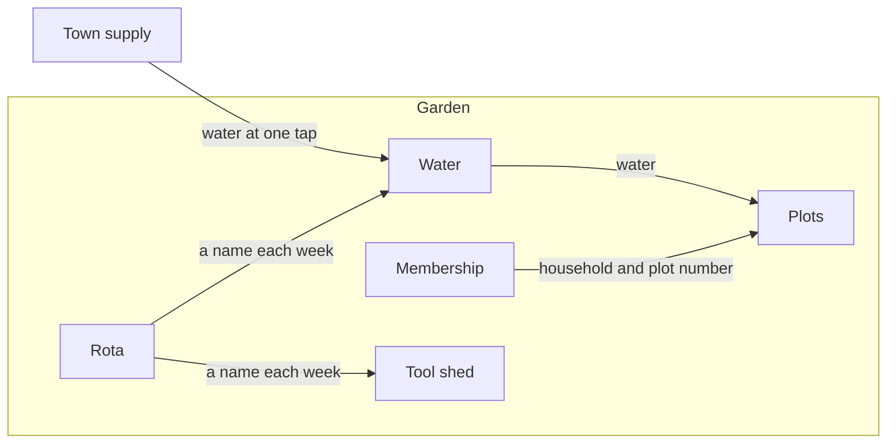

# Example: a community garden (companion to the StrataBP guide)

One way to fill the layers of the guide for an everyday subject. It illustrates the structure; it is not a template. Every fact is made up. Layer 3 and Layer 4 are written for one part, Water.

## Layer 1: Vision

Scope: the whole garden.

### 1. Need
Households on one street have no yard and nowhere to grow food together.

### 2. Target audience
The households on the street without a yard (actors). Also the neighbours who live beside the plot and the owner of the land (outsiders).

### 3. Value
- Given a household without a yard, when it joins, then it has a plot of its own for the season.
- Given a dry week, when a member comes to water, then water is at the plot and no one carries it from home.
- Given a member who is away for two weeks, when the plants need care, then a person on the rota waters them.

### 4. Focus
Growing food on shared land: plots, water, tools and a weekly rota.

### 5. Success measures
By the end of spring every plot is in use. In summer no plot goes more than two days without water. Someone walks the garden every Sunday and counts both.

### 6. Qualities and constraints
Fair: every household gets a plot of the same size and the same access to water. Cost: a small yearly fee for each household. Time: the land is lent for five years. Rule from the neighbours: no sprays.

### 7. Vocabulary
- Plot: a marked square of ground used by one household.
- Rota: the weekly list of who looks after the shared things.
- Season: spring to autumn.

### 8. Assumptions and decisions
A1.1. Most members arrive on foot. Basis: the member survey. If wrong: the entrance moves.
A1.2. Eight households will join. Basis: the sign-up sheet from the street meeting. If wrong: plots are cut smaller or some stay empty.
D1.1. Each household gets one plot, all the same size. Reason: it keeps the sharing fair without argument.

## Layer 2: Architecture

Scope: the whole garden.

### 1. Parts
- Membership (part): keeps the list of households and which plot each holds.
- Plots (part): the marked ground each household grows in.
- Water (part): brings water from the town supply to every plot.
- Tool shed (part): keeps the shared tools safe and in order.
- Rota (part): names who looks after each shared thing each week.

### 2. Standing
All five parts are described inside this stack. None is used on its own.

### 3. Seams between parts
- Membership to Plots: a household name and a plot number cross, so each plot has one holder.
- Water to Plots: water crosses to every plot, so each gets the same access.
- Rota to Water and to Tool shed: a name crosses each week, so one person answers for each.

### 4. Seams with the outside
- The town supply (outsider) to Water: water comes in at one tap by the gate; nothing goes out.
- The landowner (outsider) to the garden: the right to use the land comes in; a yearly note on how it is kept goes out.
- The neighbours (outsiders) to the Rota: complaints come in; the Rota names who answers.

### 5. Shared things
The gate, the paths and the notice board. Every part relies on them.

### 6. Scenario paths
- Joining: Membership records the household, Plots gives it a plot, Rota adds it to the weekly list.
- Dry week: Rota names who opens the tap, Water sends water to the plots, the member finds water at the plot.
- Away for two weeks: Membership notes the absence, Rota names a stand-in, the stand-in waters from the barrels in Water.

### Diagrams (optional)
These supplement the text above. The scope is the whole garden.

Title: Garden, what contains what.
```
Community garden (subject)
├─ Membership (part)
├─ Plots (part)
├─ Water (part)
├─ Tool shed (part)
└─ Rota (part)
```

Title: Garden, seam list. Each line reads from the one that gives to the one that receives.
```
Membership → Plots: household name and plot number
Water → Plots: water
Rota → Water: a name each week
Rota → Tool shed: a name each week
Town supply (outsider) → Water: water at one tap
```

Title: Garden, parts and seams. Key: arrows point from the one that gives to the one that receives; the town supply is outside the garden.


### 7. Assumptions and decisions
A2.1. The town tap gives enough water for all plots. Basis: none. If wrong: Water needs a second source.
D2.1. Water is one part, not three. Reason: one person answers for it.

## Layer 3: Components

Scope: one part, Water.

### 1. Responsibility
Water is accountable for every plot being able to get water in the growing season.

### 2. Concepts and states
- The tap: open or shut.
- A barrel: full, low or empty.
- A leak: found, reported, fixed.

### 3. Seams
- To Plots, offers: a barrel with water within five steps of every plot.
- From the town supply, needs: water at the tap by the gate.
- From the Rota, needs: a named person each week who opens and shuts the tap.

### 4. Rules
- Given a barrel that is low, when the person on the rota sees it, then they fill it before they leave.
- Given a leak, when anyone finds it, then they shut the tap and tell the person on the rota.
- Given a forecast of frost, when the person on the rota visits, then they shut the tap and drain the hose.

### 5. Inside
Three pieces: the tap, the barrels and the hose. They are described here, not in stacks of their own, and they are not listed in Layer 2.

### 6. Limits
- No plot goes more than two days without water (Layer 1, Success measures).
- Every plot is within five steps of a barrel (Layer 1, Qualities and constraints, fair access).

### 7. Assumptions and decisions
A3.1. Four barrels hold enough for a week in summer. Basis: last year's use at the old garden. If wrong: add a barrel.
D3.1. Five steps is the reach limit. Reason: it is the farthest an older member will carry a full can.

## Layer 4: Specification

Scope: one part, Water.

### 1. Construction
Water is one tap by the gate, a 30 metre hose and four barrels. Each barrel holds 200 litres, stands on a block, has a lid, and has a small tap near its base. The barrels stand so that every plot is within five steps of one.

### 2. Exact seams
- Barrel tap: 30 cm above the ground, with room for a 10 litre can beneath it.
- Fill level: up to the 190 litre mark, never above.
- Town tap: shut and drained from the first frost until spring.
- Hose coupling: Not supplied: the thread size of the town tap.

### 3. Verification
- Given a barrel below the 50 litre mark, when the person on the rota ends the visit, then it stands at the 190 litre mark.
- Given the first frost, when the hose is drained, then no water runs from the town tap.
- Given every plot, when someone counts the steps to the nearest barrel, then the count is five or fewer.

### 4. Assumptions and decisions
A4.1. A 10 litre can is the largest one members bring. Basis: none. If wrong: the barrel tap moves higher.
D4.1. Barrels stand on blocks. Reason: a can fits under the tap without lifting the barrel.

## What to notice

- Layer 1 names no parts and no tools; each later layer refers only inward.
- A missing fact is written as `Not supplied: <what is needed>`, never guessed.
- Every assumption says what it rests on and what changes if it is wrong. Every decision says why.
- A value scenario in Layer 1 reappears as a path in Layer 2, as a rule in Layer 3, and as a check in Layer 4.
- The three pieces of Water appear only inside Water's entry in Layer 3.
